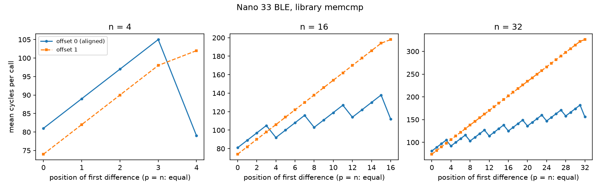
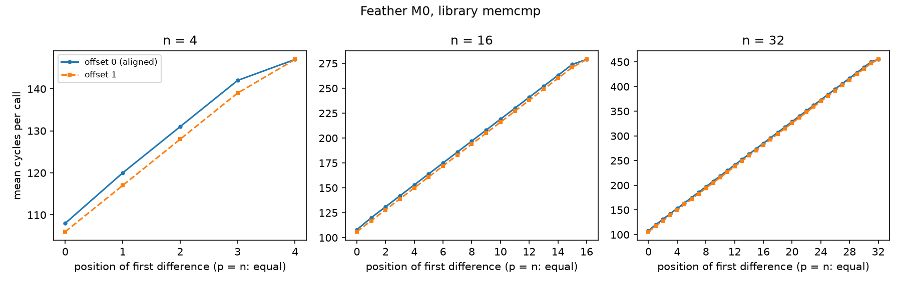

# Scorecard: predictions against the Nano 33 BLE and Feather M0 runs

Built with AI assistance (Claude). Predictions are in [PREDICTIONS.md](PREDICTIONS.md) (the Nano ones from revision 2, the Feather ones from revision 3, each written after reading the code in my own build and before running the board); the captures are `bench/logs/nano_run1.log` and `bench/logs/feather_run1.log`.
`tests/test_scorecard_nano.py` and `tests/test_scorecard_feather.py` check every row below against the logs, so this page cannot drift from the data.

## Arduino Nano 33 BLE (Cortex-M4F)

## The run

Arduino Nano 33 BLE (nRF52840, Cortex-M4F), Zephyr 4.4.2, firmware built with the Zephyr SDK 1.0.1 compiler (GCC 14.3.0), CPU clock measured at 63.99 MHz, interrupts masked around each timed call, 1000 timed calls per case, 5 complete runs, no damaged lines, no wrong answers.
**Every one of the 165 cases was perfectly repeatable: the same cycle count on all 1000 calls, and the same in all 5 runs.** With no variation at all, the Welch t is undefined; the checker reports an infinite t when two such cases differ and 0 when they are identical.

## Results

| Function | n | Cycles when the first difference is at byte 0 | at the last byte | Slope (cycles per byte) |
|---|---|---|---|---|
| `cmp_ct` (my secure link's loop) | 4 / 16 / 32 | 86 / 182 / 310 | the same | 0 |
| `cmp_naive` (early exit) | 4 / 16 / 32 | 55 | 79 / 175 / 303 | 8.00 |
| `cmp_memcmp` (the library, aligned buffers) | 4 / 16 / 32 | 92 | 116 / 149 / 193 | 8.00 / 3.06 / 2.83 |

## Predictions against measurements

| # | Predicted | Measured | Verdict |
|---|---|---|---|
| P4 | naive loop: 8 to 11 cycles per matching byte | 8.00 at every length | hit, at the bottom of the range |
| P5 | constant-time loop: the same count whatever the data, within 3 cycles | spread 0.00; 86, 182 and 310 cycles for 4, 16 and 32 bytes, so 8.0 cycles per byte | hit, exactly |
| P6 | `memcmp`: slope 7 to 10 / 3.0 to 3.9 / 2.8 to 3.6 and spread 21 to 30 / 54 to 72 / 98 to 128 for n = 4 / 16 / 32; a step of 11 to 14 cycles per four bytes | slope 8.00 / 3.06 / 2.83; spread 24 / 57 / 101; every step exactly 11, and 8 per byte inside a word | hit on every range; two sit at the lower edge (the 2.83 slope, the step of 11), because my model's 12 cycles per word was one cycle high |
| P7 | for a 4-byte tag, first byte against last byte differs by 21 to 30 cycles | 24 cycles = 0.375 microseconds | hit |
| P8 | \|t\| above 4.5 for the naive loop and `memcmp`, below 4.5 for the constant-time loop | infinite (no variance, means differ) for both early-exit functions, 0 for `cmp_ct` | hit |

Two earlier guesses were wrong and were corrected before the run, both because I had read the wrong code: revision 1 assumed a byte-loop `memcmp` (my sandbox's library), and my own build's library compares words first.

## What it shows

- **The secure link's comparison does what it is meant to.** On this build, `ct_equal` takes exactly the same time whether the strings are equal or differ at any byte: 86 cycles for a 4-byte tag, in all 5 runs.
- **Early exit leaks exactly, with no noise to hide it.** The naive loop leaks 8 cycles per matching byte; the library `memcmp` leaks in a staircase (8 cycles per byte inside a four-byte word, 11 per whole word before it).
- **The constant-time loop costs nothing extra here.** At n = 32 it takes 310 cycles, against 307 for the naive loop's worst case.

## What it does not show

One board, one compiler, one set of aligned buffers: with an unaligned pointer this `memcmp` takes its byte loop; I ran that afterwards, see the section on unaligned buffers at the end. Interrupts were masked and nothing else was running, which is why there is no noise at all; a real attacker faces whatever noise sits between them and the comparison.
A 4-byte tag leaks 0.375 microseconds here, and I have not argued whether that could be used from a radio (my argument is in the predictions, and it is an argument, not a measurement). Nothing here says whether the leak of `memcmp` in the bootloader matters: it compares a public value.

## Adafruit Feather M0 (Cortex-M0+)

### The run

Feather M0 (ATSAMD21G18), Arduino IDE with the Adafruit SAMD core, GCC 9.2.1 (Arm 9-2019-q4 toolchain), default -Os, CPU clock measured at 48.001 MHz against `micros()`, interrupts masked around each timed call, cycles counted by timer TC4+TC5 at the CPU clock, 1000 timed calls per case, 5 complete runs, no damaged lines, no wrong answers.
Reading the counter costs 36 cycles by itself (the log reports it), so absolute counts include that; differences between cases do not.
`cmp_ct` was perfectly repeatable. In all 110 cases of the two early-exit functions exactly one of the 1000 calls took one cycle less than the rest (in 3 cases of a later run, none did); I did not investigate why.

| Function | n | Cycles when the first difference is at byte 0 | at the last byte | Slope (cycles per byte) |
|---|---|---|---|---|
| `cmp_ct` | 4 / 16 / 32 | 144 / 300 / 508 | the same | 0 |
| `cmp_naive` | 4 / 16 / 32 | 101 | 137 / 281 / 473 | 12.00 |
| `cmp_memcmp` | 4 / 16 / 32 | 110 | 144 / 276 / 452 | 11.30 / 11.02 / 11.01 |

### Predictions against measurements

| # | Predicted | Measured | Verdict |
|---|---|---|---|
| P1 | naive loop: 12 to 20 cycles per matching byte | 12.00 at every length | hit, at the bottom: the flash wait states I expected to slow the loop did not show; why, I did not investigate |
| P2 | constant-time loop: the same count whatever the data, within 2 cycles; 13 cycles per byte | spread 0.00; 144, 300 and 508 cycles for 4, 16 and 32 bytes, so 13.0 per byte | hit, exactly |
| P3 | `memcmp`: a plain byte loop, 11 to 18 cycles per byte, spread 33 / 165 / 341 cycles for n = 4 / 16 / 32, no staircase | slope 11.30 / 11.02 / 11.01, spread 34 / 166 / 342, no staircase | the slope and the shape hit; **the three spreads missed by one cycle each**, because the first matching byte costs 12 cycles instead of 11 (every other step is exactly 11). I did not find why |
| P7 | 4-byte tag, first byte against last: 36 cycles (0.75 microseconds) for the naive loop, 33 (0.69) for `memcmp` | 36 cycles (0.750 microseconds) and 34 (0.708) | naive: hit. `memcmp`: missed by one cycle |
| P8 | \|t\| above 4.5 for the naive loop and `memcmp`, below 4.5 for the constant-time loop | t from 24,000 to 263,000 for the early-exit functions, 0 for `cmp_ct` | hit |

My preview of the Feather's `memcmp`, from the newer library in my sandbox, showed a word-at-a-time version; the Arduino toolchain's library is a byte loop. I caught that by reading the code in the real build before the run, and the predictions were rewritten first.

## Across the two boards

The same source line, `memcmp(a, b, n)`, leaks differently on each board, because the library behind it differs. The constant-time loop is constant on both.

| Cycles per byte | Nano 33 BLE (Cortex-M4F) | Feather M0 (Cortex-M0+) |
|---|---|---|
| `cmp_ct` | 8, same for every input | 13, same for every input |
| `cmp_naive`, per matching byte | 8 | 12 |
| `cmp_memcmp` | a staircase: 11 per four-byte word, 8 per byte inside the word | linear: 11 per byte (the first byte 12) |

## What it shows

- **`ct_equal` does what it is meant to on both boards.** It takes the same number of cycles for every input on a Cortex-M4F and a Cortex-M0+. The secure link's real target, the STM32L072, is also a Cortex-M0+, but I did not measure it and I do not touch that chip's locked build.
- **What a library `memcmp` leaks is a property of the toolchain, not of the line of C.** The bootloader compares a public digest, so this does not matter there; it would matter for a secret.
- **The constant-time loop costs little.** At n = 32 it takes 310 cycles on the Nano against 307 for the naive loop's worst case, and 508 on the Feather against 473.

## What it does not show

One board of each kind, one compiler each, buffers aligned to four bytes (an unaligned pointer sends the Nano's `memcmp` to its byte loop; the unaligned run is in the last section), interrupts masked and nothing else running, which is why there is almost no noise.
A real attacker faces whatever noise sits between them and the comparison, and I have not argued from these numbers that a leak of this size could be used over a radio. The first Nano capture and the first Feather capture are one capture each (five runs each, identical apart from the one-cycle variation noted above).
I did not measure the STM32L072, other compiler versions or optimisation levels, or the effect of interrupts being enabled.

## Unaligned buffers (14 and 15 November 2026)

Question: does the cost of the library `memcmp` depend on whether the two pointers are 4-byte aligned? In the real Nano build it ORs the two pointers, tests the low two bits and takes a byte loop if either is set (`asm/nano_real.lst`). In the real Feather build it is a byte loop with no such test (`asm/feather_real.lst`). P9 and P10 and their reasons were committed before any run (Revisions 4 and 5 in `docs/PREDICTIONS.md`).

Method: both comparison buffers moved up by one byte (`TIMING_OFFSET 1`, logged as `ENV offset_bytes 1`), against a control run of the same build at offset 0, five complete runs each. Logs: `bench/logs/nano_off0_control.log`, `nano_off1.log`, `feather_off0_control.log`, `feather_off1.log`. Before the runs I checked that `memcmp` in each rebuilt program is the same instructions as in the listings (Nano before flashing; Feather after the upload but before any measurement, because I uploaded before exporting).

| # | Predicted | Measured | Verdict |
|---|---|---|---|
| P9 | Nano, offset 1: `memcmp` slope 8 to 11 cycles per matching byte for n = 4, 16 and 32; spread 24 to 33 / 120 to 165 / 248 to 341; no four-byte steps; the n = 32 spread not below 200 | slope 8.00 / 8.00 / 8.00; spread 24 / 120 / 248; no steps | hit on slope, spread and steps |
| P9 (one clause) | the mean at position p + 4 is 32 to 44 cycles above the mean at p | not measured separately; the constant slope of 8.00 implies 32, the bottom of the range | not scored |
| P10 | Feather, offset 1: every mean cycle count within 2 cycles of the control, position by position | largest difference 3.00 cycles (n = 32, p = 8), mean difference -2.78 | miss, by 1 cycle |
| both boards | no wrong answers | 0 on every log (T lines: Nano 877 and 847, Feather 825 and 825) | hit |

What it shows:

- On the Nano, an unaligned `memcmp` costs 8 cycles per byte, the same as the early-exit loop. Aligned it is a sawtooth that averages 2.8 to 3.1 cycles per byte at n = 16 and 32. For a 32-byte digest, first byte wrong against last byte wrong differs by 248 cycles unaligned (3.9 microseconds at the measured 63.99 MHz) and 101 aligned (1.6 microseconds). The all-equal case costs 326 cycles unaligned against 156 aligned, 170 more (2.7 microseconds).
- On the Nano, `cmp_naive` and `cmp_ct` did not change between offset 0 and 1 (largest difference 0.00 cycles).
- On the Feather, alignment makes no visible difference to the shape (a straight line at 11 cycles per byte in both). The offset 1 build was 1 to 3 cycles faster in all three functions, including `cmp_ct`, whose code is identical in both builds (mean differences -1.00 for `cmp_naive`, -2.00 for `cmp_ct`, -2.78 for `cmp_memcmp`). That looks like a build-wide shift and not an alignment effect, but I did not test why.
- A comparison of a public digest, as in the bootloader, does not need constant time, so this does not change the conclusion above. It does show that the leak of the library `memcmp` depends on where the buffers sit.

Limits:

- One offset (1) on both pointers. One pointer offset was not run, because the Nano listing tests the OR of both. Offsets 2 and 3 were not run.
- One board of each kind, one build each. The rebuilt Nano control was 9 cycles faster than the October run at every position and for every function, with identical slopes and spreads; I did not find the cause. The Feather offset 1 build was 1 to 3 cycles faster than its control; cause not found.
- I expected the two Nano binaries (offset 0 and 1) to differ in 1 to 20 bytes and they differ in 89. I did not investigate.
- I uploaded the Feather sketch before exporting it and read its listing afterwards, so the code check came after the upload, still before any measurement.
- Interrupts masked, nothing else running; no noise to speak of.

Reproduce (the comparison and the figures):

    PYTHONPATH=python python -m timing_lab.align_compare bench/logs/nano_off0_control.log bench/logs/nano_off1.log --labels "offset 0 (aligned)" "offset 1" --title "Nano 33 BLE, library memcmp" --png figures/nano_memcmp_alignment.png
    PYTHONPATH=python python -m timing_lab.align_compare bench/logs/feather_off0_control.log bench/logs/feather_off1.log --labels "offset 0 (aligned)" "offset 1" --title "Feather M0, library memcmp" --png figures/feather_memcmp_alignment.png
